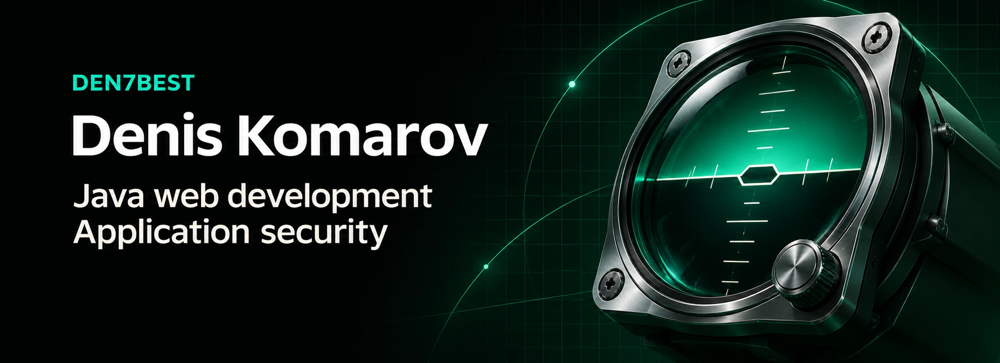
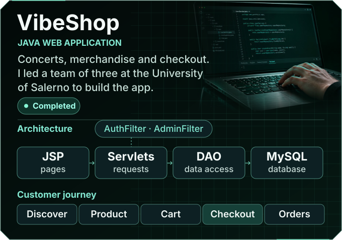

# Denis Komarov
Studio Informatica (L-31) all’Università degli Studi di Salerno e mi occupo di sviluppo web in Java.  
Napoli, Italia · **Disponibile** per stage, posizioni junior e progetti freelance.  
[Telegram @dionigi](https://t.me/dionigi) · [Read in English](./README.md)  
Ho ideato e guidato [VibeShop](https://github.com/Denis7Kom/website-turbo-layout), un progetto universitario dedicato alla musica dal vivo e al merchandising.

<picture>
  <source media="(prefers-color-scheme: light)" srcset="./.github/assets/profile-hero-light.svg">
  
</picture>

## Progetti in evidenza

### VibeShop

**Responsabile del gruppo.** Ho ideato il progetto e l’ho coordinato dall’inizio alla fine. Ho suddiviso le responsabilità, assegnato i compiti e rivisto il lavoro svolto. Ho lavorato con Ivan Perruolo e Giulio Alessandro Peluso.

Abbiamo realizzato un’app per scoprire concerti e acquistare merchandising, con catalogo, carrello e procedura d’acquisto. **Tecnologie** · Java, JSP, Servlet, DAO, SQL e MySQL.

[Repository](https://github.com/Denis7Kom/website-turbo-layout) · [Codice Java](https://github.com/Denis7Kom/website-turbo-layout/tree/main/VibeShop/src/main/java) · [Schema SQL](https://github.com/Denis7Kom/website-turbo-layout/blob/main/VibeShop/db/VIBESHOP_FINAL.sql)

Architettura e procedura d’acquisto

Le pagine sono in JSP. Le Servlet gestiscono le richieste e le classi DAO leggono e scrivono i dati in MySQL. Il percorso d’acquisto collega catalogo, carrello e ordini.

### denis-aviation

Un sito interattivo sull’aviazione con una rete di voli, un registro dei voli e una demo locale di controllo del traffico aereo.

[Visita il sito](https://denis7kom.github.io/denis-aviation/) · [Guarda il codice](https://github.com/Denis7Kom/denis-aviation)

## Sicurezza

Sto studiando l’OWASP Top 10, in particolare la SQL injection. Nel codice sviluppato dal gruppo di VibeShop si vedono una [query parametrizzata](https://github.com/Denis7Kom/website-turbo-layout/blob/main/VibeShop/src/main/java/model/dao/UserDAO.java) e i [filtri che controllano la sessione e il ruolo di amministratore](https://github.com/Denis7Kom/website-turbo-layout/tree/main/VibeShop/src/main/java/filter).

Ho approfondito anche la sicurezza dei dispositivi studiando il [progetto di miilv su Yandex Station](https://github.com/miilv/ya-station-root-shell) e la [ricerca di Ilia Ershov su Station Lite](https://github.com/ilia-ershov/yandex-station-lite-research).

Quando rivedo un problema, cerco di capirlo, di schematizzarlo e poi di verificare e migliorare la soluzione che ho implementato.

## Strumenti

- **Usati nei progetti** · Java, JSP, Servlet, SQL, MySQL, HTML, CSS, JavaScript, Git e GitHub.
- **In studio** · Sicurezza delle applicazioni web, OWASP Top 10 e SQL injection.

## Su GitHub

Puoi partire dai repository in evidenza qui sotto o [sfogliare tutti i miei repository](https://github.com/Denis7Kom?tab=repositories).

## Beyond the Code

Mi occupo anche di fotografia, riprese con il drone e scrittura. L’aviazione è uno dei miei interessi principali.

Fotografia, riprese con il drone, libri e illustrazioni aeronautiche

- [Portfolio fotografico e riprese con il drone](https://denis7kom.github.io/Denis-Komarov-PH/)
- [Fotografie su Shutterstock](https://www.shutterstock.com/g/Denis+Komarov%20PH?rid=259170704)
- [Libri su Amazon](https://www.amazon.it/stores/Denis-Komarov/author/B0CCSK74QC)

<picture>
  <source media="(prefers-reduced-motion: no-preference)" srcset="./.github/assets/header-thunder-mobile-v21.avif">
  <source media="(prefers-color-scheme: light)" srcset="./.github/assets/profile-hero-light.svg">
  
</picture>

## Contatti

Se cerchi un tirocinante, una figura junior o un collaboratore freelance, [scrivimi su Telegram](https://t.me/dionigi) indicando il ruolo o raccontandomi brevemente il progetto.
