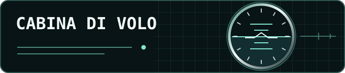
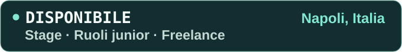
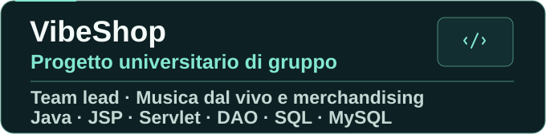
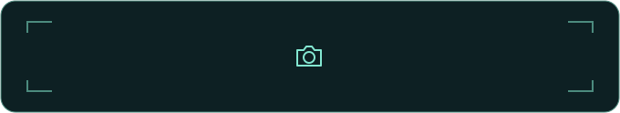
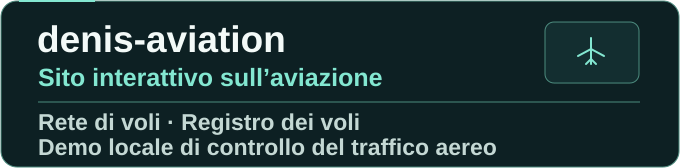

# Denis Komarov
Studio Informatica (L-31) all’Università degli Studi di Salerno e mi occupo di sviluppo web in Java.  
**Disponibile** per stage, posizioni junior e progetti freelance a Napoli, Italia.  
[Telegram @dionigi](https://t.me/dionigi) · [English](./README.md) · [Русский](./README.ru.md)

<picture>
  <source media="(prefers-color-scheme: dark)" srcset="./.github/assets/flight-deck/hero-it-dark.svg">
  <source media="(prefers-color-scheme: light)" srcset="./.github/assets/flight-deck/hero-it-light.svg">
  
</picture>

<picture>
  <source media="(prefers-color-scheme: dark)" srcset="./.github/assets/flight-deck/status-it-dark.svg">
  <source media="(prefers-color-scheme: light)" srcset="./.github/assets/flight-deck/status-it-light.svg">
  
</picture>

<picture>
  <source media="(prefers-color-scheme: dark)" srcset="./.github/assets/flight-deck/divider-dark.svg">
  <source media="(prefers-color-scheme: light)" srcset="./.github/assets/flight-deck/divider-light.svg">
  
</picture>

## Progetti in evidenza

### VibeShop

**Team lead.** VibeShop è un progetto universitario di gruppo dedicato alla musica dal vivo e al merchandising.

**Java · JSP · Servlets · DAO · SQL · MySQL**

<picture>
  <source media="(prefers-color-scheme: dark)" srcset="./.github/assets/flight-deck/vibeshop-it-dark.svg">
  <source media="(prefers-color-scheme: light)" srcset="./.github/assets/flight-deck/vibeshop-it-light.svg">
  
</picture>

[Repository](https://github.com/Denis7Kom/website-turbo-layout) · [Codice Java](https://github.com/Denis7Kom/website-turbo-layout/tree/main/VibeShop/src/main/java) · [Schema SQL](https://github.com/Denis7Kom/website-turbo-layout/blob/main/VibeShop/db/VIBESHOP_FINAL.sql)

**Catalogo di VibeShop**  
[ЗАПОЛНИ: schermata del catalogo di VibeShop]

<picture>
  <source media="(prefers-color-scheme: dark)" srcset="./.github/assets/flight-deck/screenshot-placeholder-dark.svg">
  <source media="(prefers-color-scheme: light)" srcset="./.github/assets/flight-deck/screenshot-placeholder-light.svg">
  
</picture>

**Procedura d’acquisto di prova**  
[ЗАПОЛНИ: schermata della procedura d’acquisto di prova]

<picture>
  <source media="(prefers-color-scheme: dark)" srcset="./.github/assets/flight-deck/screenshot-placeholder-dark.svg">
  <source media="(prefers-color-scheme: light)" srcset="./.github/assets/flight-deck/screenshot-placeholder-light.svg">
  
</picture>

Architettura e procedura d’acquisto

Le pagine sono in JSP. Le Servlet gestiscono le richieste e le classi DAO accedono a MySQL. Il percorso d’acquisto collega il catalogo, il carrello e gli ordini.

### denis-aviation

Un sito interattivo sull’aviazione con una rete di voli, un registro dei voli e una demo locale di controllo del traffico aereo.

<picture>
  <source media="(prefers-color-scheme: dark)" srcset="./.github/assets/flight-deck/aviation-it-dark.svg">
  <source media="(prefers-color-scheme: light)" srcset="./.github/assets/flight-deck/aviation-it-light.svg">
  
</picture>

[Visita il sito](https://denis7kom.github.io/denis-aviation/) · [Guarda il codice](https://github.com/Denis7Kom/denis-aviation)

**Rete di voli di denis-aviation**  
[ЗАПОЛНИ: schermata della rete di voli di denis-aviation]

<picture>
  <source media="(prefers-color-scheme: dark)" srcset="./.github/assets/flight-deck/screenshot-placeholder-dark.svg">
  <source media="(prefers-color-scheme: light)" srcset="./.github/assets/flight-deck/screenshot-placeholder-light.svg">
  
</picture>

<picture>
  <source media="(prefers-color-scheme: dark)" srcset="./.github/assets/flight-deck/divider-dark.svg">
  <source media="(prefers-color-scheme: light)" srcset="./.github/assets/flight-deck/divider-light.svg">
  
</picture>

## Sicurezza

Nel codice di VibeShop si vedono una [query parametrizzata](https://github.com/Denis7Kom/website-turbo-layout/blob/main/VibeShop/src/main/java/model/dao/UserDAO.java) e i [filtri che controllano la sessione e il ruolo di amministratore](https://github.com/Denis7Kom/website-turbo-layout/tree/main/VibeShop/src/main/java/filter). Sto studiando l’OWASP Top 10, in particolare la SQL injection.

<picture>
  <source media="(prefers-color-scheme: dark)" srcset="./.github/assets/flight-deck/security-it-dark.svg">
  <source media="(prefers-color-scheme: light)" srcset="./.github/assets/flight-deck/security-it-light.svg">
  
</picture>

## Strumenti

- **Usati nei progetti** · Java, JSP, Servlets, DAO, SQL, MySQL, HTML, CSS, JavaScript, Git e GitHub.
- **In studio** · OWASP Top 10, SQL injection e sicurezza delle applicazioni web.

## Su GitHub

Per vedere il mio lavoro, parti da VibeShop per lo sviluppo web in Java e da denis-aviation per il web interattivo. [Sfoglia tutti i repository](https://github.com/Denis7Kom?tab=repositories)

## Beyond the Code

Mi occupo anche di fotografia, riprese con il drone e scrittura. L’aviazione è uno dei miei interessi principali.

<picture>
  <source media="(prefers-color-scheme: dark)" srcset="./.github/assets/flight-deck/beyond-it-dark.svg">
  <source media="(prefers-color-scheme: light)" srcset="./.github/assets/flight-deck/beyond-it-light.svg">
  
</picture>

Fotografia, riprese con il drone e libri

- [Portfolio di fotografia e riprese con il drone](https://denis7kom.github.io/Denis-Komarov-PH/)
- [Shutterstock](https://www.shutterstock.com/g/Denis+Komarov%20PH?rid=259170704)
- [Libri](https://www.amazon.it/stores/Denis-Komarov/author/B0CCSK74QC)

## Contatti

Per uno stage, una posizione junior o un progetto freelance, scrivimi indicando il ruolo o descrivendo brevemente il progetto.

  
  

