<!-- All artwork is local SVG. Motion follows prefers-reduced-motion.
     Interactive controls use GitHub-native links and details/summary. -->

  

  <a href="#selected-work">Selected work</a> &nbsp; / &nbsp;
  <a href="#toolkit">Toolkit</a> &nbsp; / &nbsp;
  <a href="#explore">Explore</a> &nbsp; / &nbsp;
  <a href="#elsewhere">Elsewhere</a>

  <a href="https://denis7kom.github.io/denis-komarov/">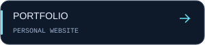</a>
  <a href="https://denis7kom.github.io/Denis-Komarov-PH/">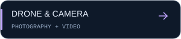</a>
  <a href="https://denis7kom.github.io/denis-aviation/">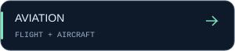</a>

  

## Selected work

  <picture><source media="(prefers-color-scheme: dark)" srcset=".github/assets/badges-v2/java-dark.svg"></picture>
  <picture><source media="(prefers-color-scheme: dark)" srcset=".github/assets/badges-v2/jsp-dark.svg">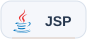</picture>
  <picture><source media="(prefers-color-scheme: dark)" srcset=".github/assets/badges-v2/servlet-dark.svg">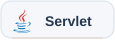</picture>
  <picture><source media="(prefers-color-scheme: dark)" srcset=".github/assets/badges-v2/html5-dark.svg"></picture>
  <picture><source media="(prefers-color-scheme: dark)" srcset=".github/assets/badges-v2/css3-dark.svg"></picture>

<b>Open project brief</b> — features, team &amp; source

 

Live-music e-commerce built by the Turbo Layout team for the Web Software Technologies course at the University of Salerno.

Concerts, artists and merchandise, with customer accounts, a shopping cart, orders and an administration area. The university version was completed and presented for the course exam.

**Team:** Denis Komarov · Ivan Perruolo · Giulio Alessandro Peluso

[Browse the code](https://github.com/Denis7Kom/website-turbo-layout) · [Read the project documentation](https://github.com/Denis7Kom/website-turbo-layout#readme)

 

  <a href="https://denis7kom.github.io/Denis-Komarov-PH/">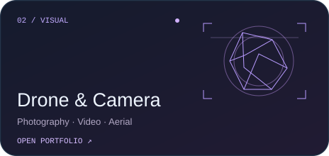</a>
  <a href="https://denis7kom.github.io/denis-aviation/"></a>

<b>Open project directory</b> — live websites &amp; repositories

 

| Project | Live website | Source |
| :--- | :--- | :--- |
| Personal portfolio | [Visit](https://denis7kom.github.io/denis-komarov/) | [denis-komarov](https://github.com/Denis7Kom/denis-komarov) |
| Drone & Camera | [View photography & video](https://denis7kom.github.io/Denis-Komarov-PH/) | [Denis-Komarov-PH](https://github.com/Denis7Kom/Denis-Komarov-PH) |
| Aviation | [Explore aircraft & flight experience](https://denis7kom.github.io/denis-aviation/) | [denis-aviation](https://github.com/Denis7Kom/denis-aviation) |

## Toolkit

**Languages**

  <picture><source media="(prefers-color-scheme: dark)" srcset=".github/assets/badges-v2/python-dark.svg">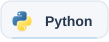</picture>
  <picture><source media="(prefers-color-scheme: dark)" srcset=".github/assets/badges-v2/c-dark.svg"></picture>
  <picture><source media="(prefers-color-scheme: dark)" srcset=".github/assets/badges-v2/csharp-dark.svg">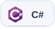</picture>
  <picture><source media="(prefers-color-scheme: dark)" srcset=".github/assets/badges-v2/cpp-dark.svg"></picture>
  <picture><source media="(prefers-color-scheme: dark)" srcset=".github/assets/badges-v2/java-dark.svg"></picture>
   
  <picture><source media="(prefers-color-scheme: dark)" srcset=".github/assets/badges-v2/php-dark.svg"></picture>
  <picture><source media="(prefers-color-scheme: dark)" srcset=".github/assets/badges-v2/ruby-dark.svg"></picture>
  <picture><source media="(prefers-color-scheme: dark)" srcset=".github/assets/badges-v2/sql-dark.svg"></picture>
  <picture><source media="(prefers-color-scheme: dark)" srcset=".github/assets/badges-v2/bash-dark.svg">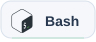</picture>
  <picture><source media="(prefers-color-scheme: dark)" srcset=".github/assets/badges-v2/assembler-dark.svg"></picture>

**Web & interfaces**

  <picture><source media="(prefers-color-scheme: dark)" srcset=".github/assets/badges-v2/html5-dark.svg"></picture>
  <picture><source media="(prefers-color-scheme: dark)" srcset=".github/assets/badges-v2/css3-dark.svg"></picture>
  <picture><source media="(prefers-color-scheme: dark)" srcset=".github/assets/badges-v2/javascript-dark.svg"></picture>
  <picture><source media="(prefers-color-scheme: dark)" srcset=".github/assets/badges-v2/react-dark.svg">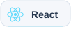</picture>
  <picture><source media="(prefers-color-scheme: dark)" srcset=".github/assets/badges-v2/jsp-dark.svg"></picture>
  <picture><source media="(prefers-color-scheme: dark)" srcset=".github/assets/badges-v2/servlet-dark.svg"></picture>

**Tools & platforms**

  <picture><source media="(prefers-color-scheme: dark)" srcset=".github/assets/badges-v2/docker-dark.svg"></picture>
  <picture><source media="(prefers-color-scheme: dark)" srcset=".github/assets/badges-v2/git-dark.svg">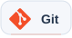</picture>
  <picture><source media="(prefers-color-scheme: dark)" srcset=".github/assets/badges-v2/github-pages-dark.svg"></picture>
  <picture><source media="(prefers-color-scheme: dark)" srcset=".github/assets/badges-v2/arduino-dark.svg"></picture>
  <picture><source media="(prefers-color-scheme: dark)" srcset=".github/assets/badges-v2/pycharm-dark.svg"></picture>

## Explore

<b>01 / Security lab</b> — open the panel

 

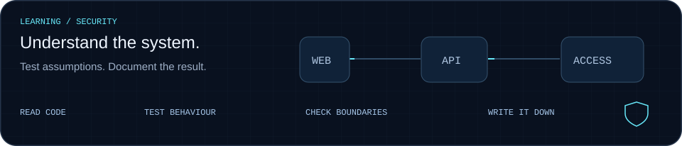

Learning cybersecurity through code, testing and documentation.

<b>02 / Behind the lens</b> — switch to visual work

 

Photography, video and aerial perspectives.

[Open Drone & Camera](https://denis7kom.github.io/Denis-Komarov-PH/) · [Shutterstock](https://www.shutterstock.com/g/Denis+Komarov%20PH?rid=259170704)

<b>03 / Flight deck</b> — explore aviation

 

Aircraft and flight experience in a dedicated aviation portfolio.

[Open the flight portfolio](https://denis7kom.github.io/denis-aviation/) · [Browse its source](https://github.com/Denis7Kom/denis-aviation)

## Elsewhere

[Personal website ↗](https://denis7kom.github.io/denis-komarov/) &nbsp; · &nbsp;
[Shutterstock ↗](https://www.shutterstock.com/g/Denis+Komarov%20PH?rid=259170704) &nbsp; · &nbsp;
[Books on Amazon ↗](https://www.amazon.it/stores/Denis-Komarov/author/B0CCSK74QC)

  

© Denis Komarov. All rights reserved.
