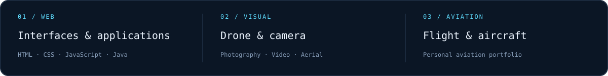
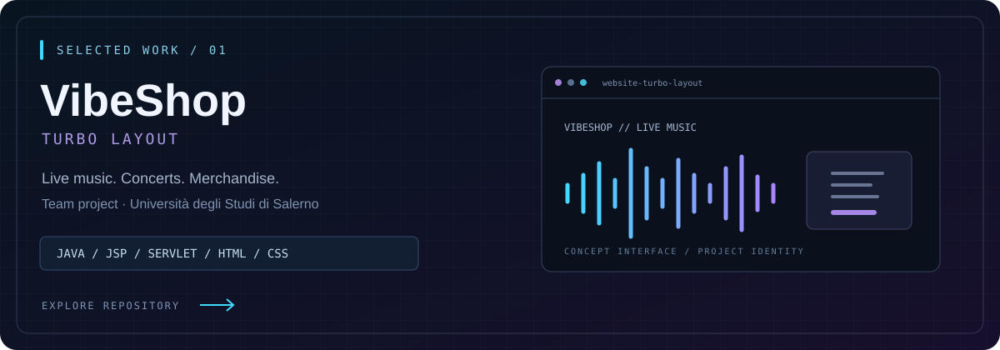

  

  
  
  

  

## Selected work

**[website-turbo-layout ↗](https://github.com/Denis7Kom/website-turbo-layout)**  
VibeShop is a live-music e-commerce project built by the Turbo Layout team for the Web Software Technologies course at the University of Salerno.

Concerts, artists and merchandise, with customer accounts, orders and an administration area.

Team: Denis Komarov · Ivan Perruolo · Giulio Alessandro Peluso

  
  
  
  

More projects — photography &amp; aviation

 

| Project | Website | Source |
| :--- | :--- | :--- |
| Drone & Camera — photography and video | [View portfolio](https://denis7kom.github.io/Denis-Komarov-PH/) | [Repository](https://github.com/Denis7Kom/Denis-Komarov-PH) |
| Aviation — flight experience and aircraft | [View portfolio](https://denis7kom.github.io/denis-aviation/) | [Repository](https://github.com/Denis7Kom/denis-aviation) |

## Toolkit

  
  
  
  
  

---

© Denis Komarov. All rights reserved.
