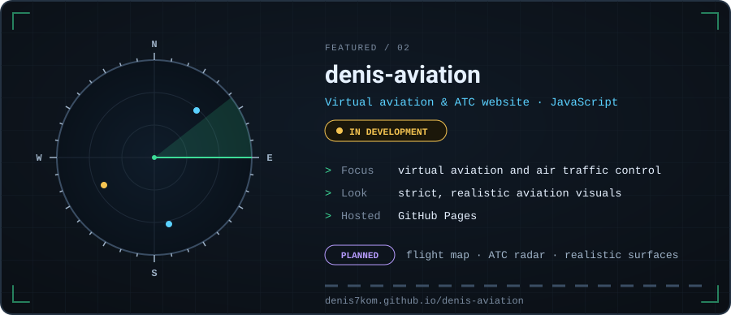

  

  <a href="#english">English</a> · <a href="#italiano">Italiano</a>

  

### English

I am a Computer Science student (L-31) at the University of Salerno, based in Naples. I build Java web applications and study application security. I am open to work: junior roles, internships and freelance web projects.

### Italiano

Sono uno studente di Informatica (L-31) all'Università di Salerno e vivo a Napoli. Sviluppo applicazioni web in Java e studio la sicurezza applicativa. Sono disponibile a lavorare: ruoli junior, tirocini e progetti web freelance.

## Featured work

  

**VibeShop** is a Java web application for live-music commerce, built as a team project for the University of Salerno. It has accounts, a catalogue, a cart, checkout, order history and an admin area. I was the team lead. The project is finished.

- Code: [`website-turbo-layout`](https://github.com/Denis7Kom/website-turbo-layout)
- Stack: Java, JSP, Servlets, DAO, SQL, HTML/CSS
- Security: the source contains `AuthFilter` and `AdminFilter`. Object-level authorisation (can user A open user B's order?) has not been audited yet.

**VibeShop** è un'applicazione web Java per scoprire concerti e artisti e acquistare merchandising, sviluppata come progetto di gruppo per l'Università di Salerno. Include account, catalogo, carrello, checkout, storico ordini e area amministrativa. Ero il team leader. Il progetto è concluso.

  

**denis-aviation** is a website about virtual aviation and air traffic control, written in JavaScript and still in development. Planned: a flight map, an ATC radar and realistic aircraft surfaces.

- [Live demo](https://denis7kom.github.io/denis-aviation/) · [Source](https://github.com/Denis7Kom/denis-aviation)

**denis-aviation** è un sito sull'aviazione virtuale e sul controllo del traffico aereo, scritto in JavaScript e ancora in sviluppo. In programma: mappa dei voli, radar ATC e superfici realistiche degli aerei. [Demo online](https://denis7kom.github.io/denis-aviation/) · [Codice](https://github.com/Denis7Kom/denis-aviation)

## Application security

  

I am learning how web applications fail. So far I have studied the OWASP Top 10 and SQL injection. I also follow the annual Cisco cybersecurity events and the security coverage of 404 Media. I do not claim certifications, audits or reported vulnerabilities.

Sto imparando come falliscono le applicazioni web. Finora ho studiato la OWASP Top 10 e la SQL injection. Seguo anche gli eventi annuali di Cisco sulla cybersicurezza e gli articoli di 404 Media sul tema. Non dichiaro certificazioni, audit o vulnerabilità segnalate.

## Toolkit

  

The left panel lists what appears in my repositories. The right panel lists what I am studying. / Il pannello a sinistra elenca ciò che compare nei miei repository. Quello a destra elenca ciò che sto studiando.

## Community

**Culobomb-Labs** is a university society at UNISA (L-31). We build tools that make studying easier for students. → [github.com/Culobomb-Labs](https://github.com/Culobomb-Labs)

**Culobomb-Labs** è un'associazione universitaria dell'UNISA (L-31). Sviluppiamo strumenti che rendono lo studio più semplice per gli studenti.

## Contact · Contatti

  

- Telegram: [@dionigi](https://t.me/dionigi)
- Portfolio: [denis7kom.github.io/denis-komarov](https://denis7kom.github.io/denis-komarov/)
- Languages · Lingue: Russian (native) · Italian B2 · English B2 · German A2

## Beyond the code · Oltre il codice

  

Photography, aerial video, writing and a personal tourism initiative.
Fotografia, video aerei, scrittura e un'iniziativa personale sul turismo.

- [Drone & Camera portfolio](https://denis7kom.github.io/Denis-Komarov-PH/) · [Shutterstock](https://www.shutterstock.com/g/Denis+Komarov%20PH?rid=259170704)
- [Books · Libri](https://www.amazon.it/stores/Denis-Komarov/author/B0CCSK74QC)
- **DeA**: a personal, not yet registered initiative that promotes tourism in Scalea and Naples. · Un'iniziativa personale, non ancora registrata, che promuove il turismo a Scalea e Napoli.
