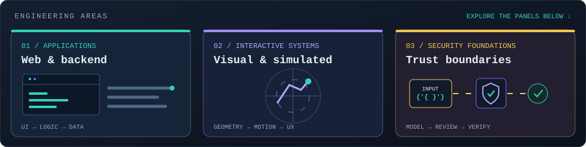
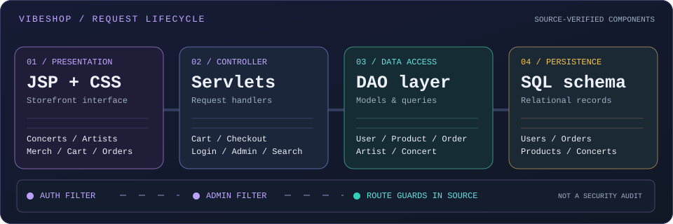
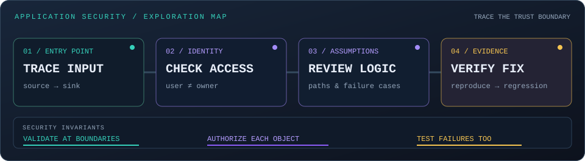
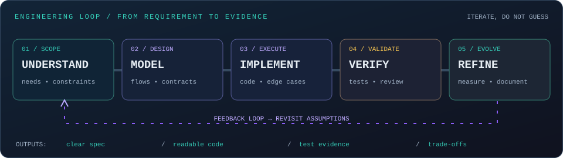
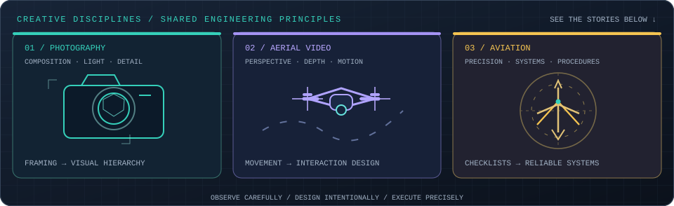

<strong>Software · Interactive Systems · Application Security</strong>

<a href="#featured-work">Projects</a> &nbsp; / &nbsp;
<a href="#cybersecurity">Security</a> &nbsp; / &nbsp;
<a href="#toolkit">Toolkit</a> &nbsp; / &nbsp;
<a href="#github-overview">Activity</a> &nbsp; / &nbsp;
<a href="#connect">Connect</a>

 

## whoami

<b>$ inspect --identity</b> — developer profile &amp; current focus

I build **software applications and interactive systems** with attention to behaviour, data flow and visual structure. Alongside software engineering, I study **application security**, especially trust boundaries, access control and verification.

| Engineering lens | What it means in practice |
| :--- | :--- |
| **Build** | Understand the user journey, model the data and implement readable behaviour. |
| **Experience** | Use movement, visual feedback and meaningful interaction rather than decoration alone. |
| **Security** | Question assumptions, inspect permissions and test what happens when requests fail. |
| **Improve** | Observe results, revise the implementation and document relevant trade-offs. |

<b>$ cat ./current-quest</b> — learning &amp; iteration

**Working approach:** understand the problem → model the states → build → verify → refine.

Focus areas describe projects, interests and ongoing learning, not unsupported claims about seniority or proficiency.

## What I Build

Click a topic to expand a technical view. These are areas of work and study, not a claim of equal proficiency in every technology.

<b>01 / Applications</b> — interface → request handling → persistence

**I build around behaviour, not just screens.** A feature is the full path from user interaction through business logic to stored data.

- **Frontend:** accessible navigation, responsive layouts, meaningful interaction states.
- **Backend:** request handling, validation, sessions, error paths and predictable business rules.
- **Data layer:** relational models, persistence and consistent state across user journeys.
- **Example:** in [VibeShop](https://github.com/Denis7Kom/website-turbo-layout), the customer journey connects JSP pages, Servlets, DAO classes and relational data.

`USER ACTION → CONTROLLER → DOMAIN LOGIC → DATABASE → RESPONSE`

<b>02 / Interactive Systems</b> — visual logic, motion &amp; simulation

A convincing interactive experience needs more than visual effects: the behaviour, animation state and user controls must agree.

- Procedural geometry and interactive 3D scenes.
- Event-driven updates, transitions and state-dependent visuals.
- Controls designed for both desktop and mobile interfaces.
- Iteration on usability and performance, not only appearance.

`INPUT → UPDATE STATE → RENDER → FEEDBACK`

<b>03 / Security Foundations</b> — boundaries, assumptions &amp; verification

My ongoing security learning focuses on the application's trust boundaries: where user-controlled input arrives, where identity is verified and where access must be checked.

- Track data from entry points to sensitive operations.
- Separate authentication (**who is the user?**) from authorisation (**can they access this object?**).
- Review failure paths and look for missing checks.
- Verify changes with positive **and** negative test cases.

`DEFINE BOUNDARY → FIND ASSUMPTION → TEST FAILURE → VERIFY FIX`

## Featured Work

SELECTED PROJECT / 01 — the only featured work on this profile.

### VibeShop · Turbo Layout

A **Java web application for live-music commerce**, developed as a team project for the University of Salerno. It connects **concert and artist discovery** with a real e-commerce workflow: accounts, product selection, cart, checkout, order history and administrative management.

**Stack:** `Java` · `JSP` · `Servlets` · `HTML/CSS` · `SQL` · `DAO`

<b>Explore the customer journey</b> — guest → member → order

| Stage | Behaviour |
| :--- | :--- |
| **Discover** | Browse concerts, artists and merchandise; search the catalogue. |
| **Account** | Register, sign in and access an individual profile. |
| **Select** | Add products to a cart and review the purchase. |
| **Checkout** | Complete an order as an authenticated customer. |
| **Track** | Review past orders and manage profile information. |

**Flow:** `DISCOVER` → `PRODUCT` → `CART` → `CHECKOUT` → `ORDERS`

<b>Explore the admin view</b> — catalogue, events &amp; operations

The project includes a separate administration area for maintaining concerts and merchandise, reviewing orders and managing support requests.

The source tree contains dedicated administrative Servlets and an `AdminFilter`. Their presence documents the application's routing structure; it does **not** by itself establish that every authorisation path has been independently audited.

<b>Under the hood</b> — explore real source files

| Layer | Implementation |
| :--- | :--- |
| **Views** | [JSP pages](https://github.com/Denis7Kom/website-turbo-layout/tree/main/VibeShop/src/main/webapp/jsp) for catalogue, cart, checkout, account and orders |
| **Request layer** | [Java Servlets](https://github.com/Denis7Kom/website-turbo-layout/tree/main/VibeShop/src/main/java/com/turbolayout) including `CartServlet`, `CheckoutServlet`, `LoginServlet` and `SearchServlet` |
| **Domain layer** | [Model classes](https://github.com/Denis7Kom/website-turbo-layout/tree/main/VibeShop/src/main/java/model) for users, products, concerts, cart items and orders |
| **Data access** | [DAO classes](https://github.com/Denis7Kom/website-turbo-layout/tree/main/VibeShop/src/main/java/model/dao) for user, artist, concert, product and order data |
| **Database** | [SQL schema](https://github.com/Denis7Kom/website-turbo-layout/blob/main/VibeShop/db/VIBESHOP_FINAL.sql) |
| **Access filters** | [AuthFilter / AdminFilter](https://github.com/Denis7Kom/website-turbo-layout/tree/main/VibeShop/src/main/java/filter) |

The university project is **completed**. Future refactoring and application-security hardening are listed as potential follow-up work, not finished features.

Team: Denis7Kom · Ivan Perruolo · Giulio Alessandro Peluso.

## Cybersecurity

I am building my **application-security knowledge** by connecting security concepts to actual software behaviour. The emphasis is on reproducible findings, clear trust boundaries and verifiable fixes.

<b>01 / Threat modelling</b> — what can cross a trust boundary?

**Threat modelling** is the practice of identifying assets, entry points, trust boundaries and plausible failure scenarios *before* assuming a feature is safe.

Example: a browser sends an order ID to a Servlet. The server must establish whether the authenticated user is allowed to access that specific order—not merely whether they are logged in.

`USER INPUT → SESSION → OBJECT LOOKUP → OWNER CHECK → RESPONSE`

<b>02 / Authentication &amp; authorisation</b> — identity is not permission

- **Authentication** establishes an identity, for example through a valid user session.
- **Authorisation** evaluates an action against an object and its owner or role.
- **IDOR/BOLA** describes missing object-level authorisation, such as reading another customer's order by changing an identifier.

In VibeShop, `AuthFilter` and `AdminFilter` are concrete code locations to study. A filter alone is not proof that every object-level permission has been enforced.

<b>03 / Input &amp; data handling</b> — validate at each boundary

I focus on where untrusted input meets business logic and storage: parameter validation, SQL query construction, output encoding and error handling.

**Example review question:** when a search string reaches a DAO, is it safely bound as data rather than interpreted as query syntax? The answer requires inspecting the implementation, not trusting the UI.

<b>04 / Reproduction &amp; regression tests</b> — demonstrate the fix

A useful security review produces evidence: initial conditions, a repeatable request, the observed result, the expected result and a test that prevents recurrence.

`REPRODUCE → IDENTIFY ROOT CAUSE → CHANGE CODE → RETEST → DOCUMENT`

**Status:** learning and exploring. These are focus areas and review methods, not claimed certifications, vulnerability discoveries or a completed audit of VibeShop.

## Toolkit

<em>Languages and tools across projects and ongoing exploration; depth varies by technology.</em>

<strong>Languages</strong> 

<strong>Web & Interactive Graphics</strong> 

<strong>Workflow & Platforms</strong> 

## GitHub Overview

Public GitHub activity. Language charts describe repository composition.

## My Build Pattern

The goal is a **repeatable path from a requirement to observable behaviour**, with enough evidence to know whether the implementation meets the intended contract.

<b>01 + 02 / Understand &amp; Model</b> — requirements, states and boundaries

Start with the user journey and the system's constraints. Separate *what should happen* from *how it will be implemented*. Sketch state transitions, important data entities, expected errors and trust boundaries.

**VibeShop example:** product discovery → cart → authenticated checkout → order history. Each transition implies a request, a change of state or an access rule.

<b>03 / Implement</b> — explicit responsibilities, readable code

Separate view rendering, request coordination, domain state and persistence. Prefer descriptive names and small responsibilities over clever abstractions without a clear benefit.

**VibeShop example:** JSP is the presentation layer; Servlets handle requests; model classes carry state; DAO classes interact with persistence.

<b>04 / Verify</b> — successful paths, failures and edge cases

Review what happens when inputs are missing, an object does not exist, a session expires, permissions are insufficient or a request repeats. Validate the observable result rather than assuming a code change solved the problem.

**Example test cases:** empty cart; expired session during checkout; account A requesting account B's order.

<b>05 / Refine</b> — performance, security &amp; documentation

Measure the actual bottleneck before optimising. Reduce complexity where possible, revisit exposed trust boundaries and document the trade-offs that future maintainers need to understand.

`OBSERVE → EXPLAIN → CHANGE ONE THING → VERIFY AGAIN`

## Beyond the Code

**Different disciplines, shared habits:** composition, movement and precision influence how I approach software and visual projects. Expand a subject to explore its connection to engineering.

<b>01 / Photography</b> — composition, light &amp; attention to detail

Photography is an exercise in deliberate choices: what belongs in the frame, what should stand out and what distracts from the subject.

**Connection to software:** the same discipline applies to visual hierarchy, spacing, contrast and interface clarity.

- **Composition → layout:** place important actions where users can find them.
- **Light & contrast → readability:** separate content and interface states without visual noise.
- **Editing → iteration:** compare alternatives and remove what does not communicate.

**Practical example:** a dashboard can show correct data but still be difficult to use when every element competes for attention.

[Drone & Camera portfolio](https://denis7kom.github.io/Denis-Komarov-PH/) · [Shutterstock photography](https://www.shutterstock.com/g/Denis+Komarov%20PH?rid=259170704)

<b>02 / Aerial Video</b> — perspective, motion &amp; spatial storytelling

Aerial footage combines framing, movement and a changing point of view. Smooth camera work should help someone understand a scene rather than simply adding motion.

**Connection to software:** interactive 3D scenes, camera controls and motion design also depend on predictable movement and feedback.

- **Perspective → spatial reasoning:** understand objects in relation to their environment.
- **Camera movement → interaction:** keep orientation clear while the viewpoint changes.
- **Visual continuity → UX:** transitions should clarify what changed and where to look next.

**Practical example:** when a user rotates a 3D model, stable controls and a clear focal point matter more than elaborate effects.

[View aerial photography and video](https://denis7kom.github.io/Denis-Komarov-PH/)

<b>03 / Aviation</b> — systems thinking, procedures &amp; precision

Aviation inspires my interest in interconnected systems, operational logic and interfaces that express changing states.

**Connection to software:** understandable systems make dependencies, control inputs and failure cases explicit.

- **Checklists → consistency:** document repeated steps and reviewable decisions.
- **Cockpit displays → information design:** present relevant information at the right time.
- **Aircraft systems → state modelling:** controls must correspond to coherent system states.
- **Procedures → verification:** distinguish intended behaviour from what happened.

**Practical example:** interactive aircraft models need consistent relationships between controls, flight surfaces, landing gear and the visible aircraft state.

[Interactive aviation project](https://denis7kom.github.io/denis-aviation/) · [GitHub source](https://github.com/Denis7Kom/denis-aviation)

<b>04 / Writing</b> — structure, clarity &amp; documentation

Writing is another way to organise complex material into something understandable. Good documentation asks the same questions as good storytelling: what does the reader need to know first, which context is missing and how does the argument progress?

**Connection to software:** precise names, clear explanations and structured documentation make technical projects easier to understand and maintain.

[My books](https://www.amazon.it/stores/Denis-Komarov/author/B0CCSK74QC)

## Connect

  

