 

 

<a href="#featured-work">Projects</a> &nbsp; / &nbsp;
<a href="#cybersecurity">Security</a> &nbsp; / &nbsp;
<a href="#toolkit">Toolkit</a> &nbsp; / &nbsp;
<a href="#github-overview">Activity</a> &nbsp; / &nbsp;
<a href="#connect">Connect</a>

 

<table>
<tr>
<td width="55%" valign="top">

## About Me

<b>Explore my development focus</b>

I focus on application logic, data flow and the behaviour behind the interface. I am expanding my expertise in cybersecurity and secure software development.

</td>
<td width="45%" valign="middle">

</td>
</tr>
</table>

## What I Build

| `01` **Applications** | `02` **Interactive Systems** | `03` **Security Foundations** |
| :---: | :---: | :---: |
| Web flows, interfaces and persistent data | Procedural geometry, rendering and simulation | Input handling, access boundaries and verifiable fixes |

## Featured Work

Click a card to open the project. Expand its panel for technical details.

<b>Explore VibeShop</b> — implementation, stack &amp; links

Live-music e-commerce with customer accounts, a shopping cart, orders and an administration area. Built with **Java, JSP, Servlets and a relational database** for the University of Salerno.

[Source & documentation](https://github.com/Denis7Kom/website-turbo-layout)

Team: Denis7Kom · Ivan Perruolo · Giulio Alessandro Peluso

 

<b>Explore Aviation</b> — implementation, stack &amp; links

Browser-based procedural aircraft, moving components, a flight network, a logbook and a flight-control demo. **JavaScript, WebGL, cached geometry and regression checks.**

[Live experience](https://denis7kom.github.io/denis-aviation/) · [Source](https://github.com/Denis7Kom/denis-aviation) · [Architecture](https://github.com/Denis7Kom/denis-aviation/blob/main/docs/architecture.md)

 

<b>Explore BINARIO</b> — implementation, stack &amp; links

A multilingual railway guide with an interactive 3D station and Russian, English and Italian editions. **JavaScript, Three.js, HTML and CSS.**

[Live guide](https://denis7kom.github.io/trains_it/en/) · [Source & workflow](https://github.com/Denis7Kom/trains_it)

 

<b>Explore Goblin</b> — implementation, stack &amp; links

An Italian-language console RPG prototype written in **C**, with combat, a shop, character statistics and timed events. Known input-handling and correctness issues are documented for future work.

[Source](https://github.com/Denis7Kom/goblin/blob/main/goblin.it.c) · [Roadmap](https://github.com/Denis7Kom/goblin/blob/main/ROADMAP.md)

 

## Cybersecurity

<b>Open security learning notes</b> — four areas of focus

I am developing my application-security knowledge through code review, testing and understanding implementation failures.

- **Input handling:** malformed data, validation and memory-safety failures.
- **Authentication & authorisation:** identity, sessions and access boundaries.
- **Secure code review:** data flow, assumptions and failure paths.
- **Verification:** reproduce the problem, understand its cause and check the fix.

## Toolkit

<em>Languages and tools across projects and ongoing exploration; depth varies by technology.</em>

<strong>Languages</strong> 

<strong>Web & Interactive Graphics</strong> 

<strong>Workflow & Platforms</strong> 

## GitHub Overview

Public GitHub activity. Language charts describe repository composition.

## My Build Pattern

Understand the problem, make the implementation readable, test meaningful behaviour and document the trade-offs.

## Beyond the Code

Photography, aerial video and aviation also shape my visual work.

[Drone & Camera](https://denis7kom.github.io/Denis-Komarov-PH/) · [Shutterstock](https://www.shutterstock.com/g/Denis+Komarov%20PH?rid=259170704) · [Books](https://www.amazon.it/stores/Denis-Komarov/author/B0CCSK74QC)

## Connect

  

