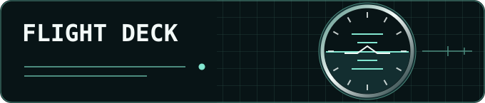
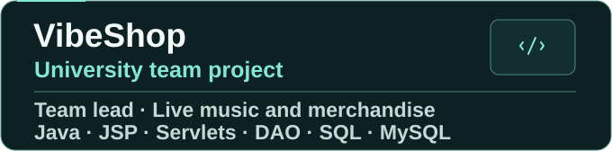
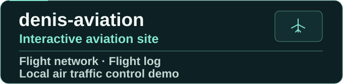

# Denis Komarov
Computer Science student (L-31) at the University of Salerno, focused on Java web development.  
**Open to work** for internships, junior roles, and freelance projects in Naples, Italy.  
[Telegram @dionigi](https://t.me/dionigi) · [Italiano](./README.it.md) · [Русский](./README.ru.md)

<picture>
  <source media="(prefers-color-scheme: dark)" srcset="./.github/assets/flight-deck/hero-en-dark.svg">
  <source media="(prefers-color-scheme: light)" srcset="./.github/assets/flight-deck/hero-en-light.svg">
  
</picture>

<picture>
  <source media="(prefers-color-scheme: dark)" srcset="./.github/assets/flight-deck/status-en-dark.svg">
  <source media="(prefers-color-scheme: light)" srcset="./.github/assets/flight-deck/status-en-light.svg">
  
</picture>

<picture>
  <source media="(prefers-color-scheme: dark)" srcset="./.github/assets/flight-deck/divider-dark.svg">
  <source media="(prefers-color-scheme: light)" srcset="./.github/assets/flight-deck/divider-light.svg">
  
</picture>

## Featured work

### VibeShop

**Team lead.** VibeShop is a university team project for live music and merchandise.

**Java · JSP · Servlets · DAO · SQL · MySQL**

<picture>
  <source media="(prefers-color-scheme: dark)" srcset="./.github/assets/flight-deck/vibeshop-en-dark.svg">
  <source media="(prefers-color-scheme: light)" srcset="./.github/assets/flight-deck/vibeshop-en-light.svg">
  
</picture>

[Repository](https://github.com/Denis7Kom/website-turbo-layout) · [Java source](https://github.com/Denis7Kom/website-turbo-layout/tree/main/VibeShop/src/main/java) · [SQL schema](https://github.com/Denis7Kom/website-turbo-layout/blob/main/VibeShop/db/VIBESHOP_FINAL.sql)

**VibeShop catalogue**  
[ЗАПОЛНИ: VibeShop catalogue screenshot]

<picture>
  <source media="(prefers-color-scheme: dark)" srcset="./.github/assets/flight-deck/screenshot-placeholder-dark.svg">
  <source media="(prefers-color-scheme: light)" srcset="./.github/assets/flight-deck/screenshot-placeholder-light.svg">
  
</picture>

**VibeShop test checkout**  
[ЗАПОЛНИ: VibeShop test checkout screenshot]

<picture>
  <source media="(prefers-color-scheme: dark)" srcset="./.github/assets/flight-deck/screenshot-placeholder-dark.svg">
  <source media="(prefers-color-scheme: light)" srcset="./.github/assets/flight-deck/screenshot-placeholder-light.svg">
  
</picture>

Architecture and checkout

JSP renders the pages, Servlets handle requests, and DAO classes access MySQL. The checkout flow connects the catalogue, cart, and orders.

### denis-aviation

Interactive aviation site with a flight network, a flight log, and a local air traffic control demo.

<picture>
  <source media="(prefers-color-scheme: dark)" srcset="./.github/assets/flight-deck/aviation-en-dark.svg">
  <source media="(prefers-color-scheme: light)" srcset="./.github/assets/flight-deck/aviation-en-light.svg">
  
</picture>

[Open the site](https://denis7kom.github.io/denis-aviation/) · [View the source](https://github.com/Denis7Kom/denis-aviation)

**denis-aviation flight network**  
[ЗАПОЛНИ: denis-aviation flight network screenshot]

<picture>
  <source media="(prefers-color-scheme: dark)" srcset="./.github/assets/flight-deck/screenshot-placeholder-dark.svg">
  <source media="(prefers-color-scheme: light)" srcset="./.github/assets/flight-deck/screenshot-placeholder-light.svg">
  
</picture>

<picture>
  <source media="(prefers-color-scheme: dark)" srcset="./.github/assets/flight-deck/divider-dark.svg">
  <source media="(prefers-color-scheme: light)" srcset="./.github/assets/flight-deck/divider-light.svg">
  
</picture>

## Security

In the VibeShop team’s code, see a [parameterized query](https://github.com/Denis7Kom/website-turbo-layout/blob/main/VibeShop/src/main/java/model/dao/UserDAO.java) and [filters that check the session and admin role](https://github.com/Denis7Kom/website-turbo-layout/tree/main/VibeShop/src/main/java/filter). I’m studying the OWASP Top 10, including SQL injection.

<picture>
  <source media="(prefers-color-scheme: dark)" srcset="./.github/assets/flight-deck/security-en-dark.svg">
  <source media="(prefers-color-scheme: light)" srcset="./.github/assets/flight-deck/security-en-light.svg">
  
</picture>

## Toolkit

- **Used in projects** · Java, JSP, Servlets, DAO, SQL, MySQL, HTML, CSS, JavaScript, Git and GitHub.
- **Learning** · OWASP Top 10, SQL injection, and web application security.

## GitHub overview

For a quick review, start with VibeShop for Java web development and denis-aviation for interactive web work. [Browse all repositories](https://github.com/Denis7Kom?tab=repositories)

## Beyond the Code

I work on photography, drone footage, and books. Aviation is one of my main interests.

<picture>
  <source media="(prefers-color-scheme: dark)" srcset="./.github/assets/flight-deck/beyond-en-dark.svg">
  <source media="(prefers-color-scheme: light)" srcset="./.github/assets/flight-deck/beyond-en-light.svg">
  
</picture>

Photography, drone footage, and books

- [Photography and drone portfolio](https://denis7kom.github.io/Denis-Komarov-PH/)
- [Shutterstock](https://www.shutterstock.com/g/Denis+Komarov%20PH?rid=259170704)
- [Books](https://www.amazon.it/stores/Denis-Komarov/author/B0CCSK74QC)

## Connect

For an internship, junior role, or freelance project, send me the role or a short project description.

  
  

