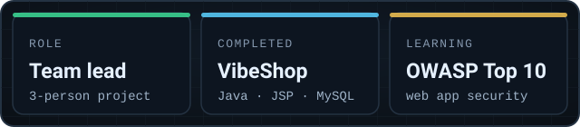

  

  
  
  

  

*Sviluppo applicazioni web in Java e imparo a renderle più sicure.* Disponibile a lavorare a Napoli.

<b>🇮🇹 Leggi in italiano</b>

Sono uno studente di Informatica (L-31) all'Università di Salerno. Il progetto principale è **VibeShop**, un'applicazione web Java per scoprire concerti e acquistare merchandising, realizzata in un gruppo di tre persone, di cui ero il team leader. Studio la sicurezza delle applicazioni web (OWASP Top 10, SQL injection). Non dichiaro certificazioni, audit o vulnerabilità segnalate.

**Culobomb-Labs** è un'associazione universitaria dell'UNISA (L-31): sviluppiamo strumenti che rendono lo studio più semplice.

**denis-aviation** è un sito sull'aviazione virtuale e sul controllo del traffico aereo, ancora in sviluppo. In programma: mappa dei voli e radar ATC.

## What I do

| I can build | Proof |
|:--|:--|
| **Java web applications** with pages, forms, login and a database | [VibeShop](https://github.com/Denis7Kom/website-turbo-layout): accounts, catalogue, cart, checkout, orders, admin area |
| **Websites** in HTML, CSS and JavaScript | [Portfolio](https://denis7kom.github.io/denis-komarov/) · [denis-aviation](https://denis7kom.github.io/denis-aviation/) |
| **Basic security checks** of my own projects (learning) | OWASP Top 10, SQL injection |

## Featured work

  

**VibeShop** is a Java web application for live-music commerce, built by a team of three at the University of Salerno. I was the team lead. The project is completed.

<!-- Add a real screenshot or a 10-second GIF here, for example:
 -->

<b>Under the hood</b>: where things live in the code

| Layer | Where |
|:--|:--|
| Pages | [JSP](https://github.com/Denis7Kom/website-turbo-layout/tree/main/VibeShop/src/main/webapp/jsp) for catalogue, cart, checkout, account and orders |
| Requests | [Servlets](https://github.com/Denis7Kom/website-turbo-layout/tree/main/VibeShop/src/main/java/com/turbolayout): `CartServlet`, `CheckoutServlet`, `LoginServlet`, `SearchServlet` |
| Data access | [DAO classes](https://github.com/Denis7Kom/website-turbo-layout/tree/main/VibeShop/src/main/java/model/dao) for user, artist, concert, product and order |
| Database | [SQL schema](https://github.com/Denis7Kom/website-turbo-layout/blob/main/VibeShop/db/VIBESHOP_FINAL.sql) |
| Access filters | [AuthFilter / AdminFilter](https://github.com/Denis7Kom/website-turbo-layout/tree/main/VibeShop/src/main/java/filter) |

The filters exist in the source. Object-level authorisation (can user A open user B's order?) has **not** been independently audited.

  

**denis-aviation** is a website about virtual aviation and air traffic control, written in JavaScript. [Live site](https://denis7kom.github.io/denis-aviation/) · [Source](https://github.com/Denis7Kom/denis-aviation)

## Application security

  

I am learning how web applications fail, and how to check that a fix really works. So far: OWASP Top 10 and SQL injection. I also follow the annual Cisco cybersecurity events and 404 Media's security coverage. I do not claim certifications, audits or reported vulnerabilities.

<b>Example question I ask of my own code</b>

A browser sends `GET /order?id=1042`. Logged in is not enough: the server must check that the order belongs to the logged-in user. Missing this check is called **IDOR** (insecure direct object reference). This is an example of a review question, not a finding.

## Toolkit

  

## Beyond the code

  

[Drone & Camera portfolio](https://denis7kom.github.io/Denis-Komarov-PH/) · [Shutterstock](https://www.shutterstock.com/g/Denis+Komarov%20PH?rid=259170704) · [Books](https://www.amazon.it/stores/Denis-Komarov/author/B0CCSK74QC) · **DeA**: a personal, not yet registered initiative promoting tourism in Scalea and Naples.

## Contact

Telegram [@dionigi](https://t.me/dionigi) · Naples, Italy · Languages: Russian (native), Italian B2, English B2, German A2.

**Culobomb-Labs**: a university society at UNISA (L-31) building study tools for students. → [github.com/Culobomb-Labs](https://github.com/Culobomb-Labs)
