<!-- Profile content uses native GitHub Markdown and repository-hosted artwork. -->

  

<h1 align="center">Software development. Interactive systems. Security.</h1>

  <b>Denis Komarov · Denis7Kom</b> 
  Building web applications and browser-based 3D experiences. 
  Expanding my expertise in cybersecurity and secure software development.

  <a href="https://denis7kom.github.io/denis-komarov/"><b>Portfolio ↗</b></a>
  &nbsp; · &nbsp; <a href="#selected-engineering-work">Projects</a>
  &nbsp; · &nbsp; <a href="#languages--toolkit">Toolkit</a>
  &nbsp; · &nbsp; <a href="#cybersecurity-direction">Security</a>

---

I work across application logic, interfaces and interactive graphics. My public projects span a Java e-commerce application, procedural aircraft rendering, a multilingual railway guide and a console RPG in C.

I care about how software behaves beneath the interface: how state changes, how data moves, how geometry is generated, and how a change can be checked.

## Selected engineering work

### 01 / VibeShop
**Java web application · University team project**

Live-music e-commerce with customer accounts, a shopping cart, orders and an administration area. Developed with the **Turbo Layout** team for the Web Software Technologies course at the University of Salerno.

**Stack:** Java · JSP · Servlets · HTML · CSS · Relational database  
**Engineering focus:** application flows, persistent data and separate customer/admin interfaces.

[Source & documentation ↗](https://github.com/Denis7Kom/website-turbo-layout)

Team: Denis Komarov · Ivan Perruolo · Giulio Alessandro Peluso

### 02 / Aviation
**Procedural 3D · Interactive browser application**

Aircraft models with moving components, a flight network, a logbook and a local flight-control demo. The project separates geometry, fleet data and application code, with a custom renderer and regression checks.

**Stack:** JavaScript · WebGL · HTML · CSS · Node.js development tooling  
**Engineering focus:** mesh generation, depth handling, cached wireframes and geometry invariants.

[Live experience ↗](https://denis7kom.github.io/denis-aviation/) · [Source](https://github.com/Denis7Kom/denis-aviation) · [Architecture](https://github.com/Denis7Kom/denis-aviation/blob/main/docs/architecture.md)

### 03 / BINARIO
**Multilingual railway guide · Interactive 3D**

A guide to Italian trains with Russian, English and Italian editions, schematic illustrations and an interactive station scene. Published as static pages, with development checks for formatting and content preservation.

**Stack:** JavaScript · Three.js · HTML · CSS · GitHub Actions  
**Engineering focus:** localisation, interactive visualisation and a fallback for browsers without WebGL.

[Live experience ↗](https://denis7kom.github.io/trains_it/en/) · [Source & checks](https://github.com/Denis7Kom/trains_it)

### 04 / Goblin
**C programming · Console RPG prototype**

An Italian-language game with combat, a shop, character statistics and timed events. An early prototype with documented limitations and a roadmap for safer input handling, correctness and game balance.

**Stack:** C  
**Engineering focus:** control flow, state transitions, input handling and resource management.

[Source ↗](https://github.com/Denis7Kom/goblin) · [Development roadmap](https://github.com/Denis7Kom/goblin/blob/main/ROADMAP.md)

## Languages & toolkit

**At work in the featured projects**

  <picture><source media="(prefers-color-scheme: dark)" srcset=".github/assets/badges-v2/java-dark.svg"></picture>
  <picture><source media="(prefers-color-scheme: dark)" srcset=".github/assets/badges-v2/javascript-dark.svg"></picture>
  <picture><source media="(prefers-color-scheme: dark)" srcset=".github/assets/badges-v2/c-dark.svg"></picture>
  <picture><source media="(prefers-color-scheme: dark)" srcset=".github/assets/badges-v2/sql-dark.svg"></picture>
  <picture><source media="(prefers-color-scheme: dark)" srcset=".github/assets/badges-v2/html5-dark.svg"></picture>
  <picture><source media="(prefers-color-scheme: dark)" srcset=".github/assets/badges-v2/css3-dark.svg"></picture>

| Area | Technologies |
| :--- | :--- |
| Web applications | Java, JSP, Servlets, relational databases |
| Interfaces & graphics | JavaScript, HTML, CSS, WebGL, Three.js |
| Development workflow | Git, Node.js tooling, GitHub Actions, GitHub Pages |
| Programming fundamentals | C, console applications, explicit state management |

<b>Broader toolkit & ongoing exploration</b>

 

My broader toolkit includes **Python, C++, C#, PHP, Ruby, Bash and assembly**, alongside **React, Docker and Arduino**. Project depth varies by technology; the selected repositories above show concrete examples of my work.

## Cybersecurity direction

I am extending my software development work into **application security**: understanding how implementation choices create vulnerabilities, testing assumptions and learning how to make fixes verifiable.

My learning priorities:

- **Input handling:** validate data, handle malformed input and understand memory-safety failures.
- **Authentication & authorisation:** understand identity, sessions and access boundaries.
- **Secure code review:** trace data through an application and examine failure paths.
- **Verification:** reproduce a problem, document its cause and check the fix.

The [Goblin roadmap](https://github.com/Denis7Kom/goblin/blob/main/ROADMAP.md) and [VibeShop development plans](https://github.com/Denis7Kom/website-turbo-layout#stato-del-progetto) identify concrete areas for future hardening.

## Beyond the code

Photography, aerial video and aviation also shape my visual work.

[Personal portfolio ↗](https://denis7kom.github.io/denis-komarov/) · [Drone & Camera](https://denis7kom.github.io/Denis-Komarov-PH/) · [Shutterstock](https://www.shutterstock.com/g/Denis+Komarov%20PH?rid=259170704) · [Books](https://www.amazon.it/stores/Denis-Komarov/author/B0CCSK74QC)

---

Build with intent. Understand the system. Verify the change.

