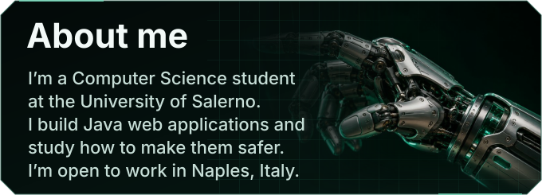
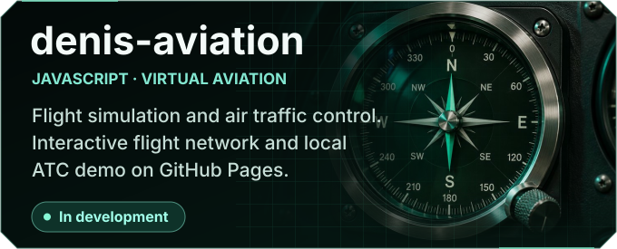
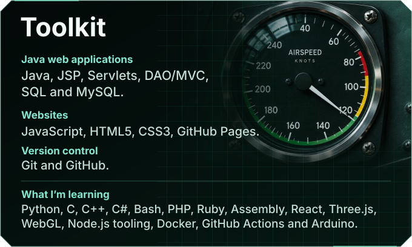
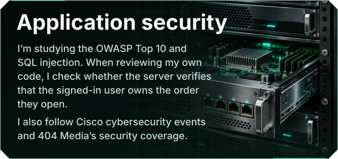
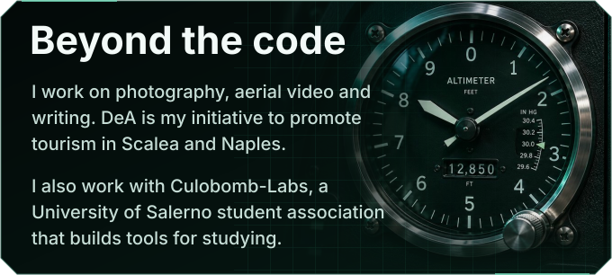
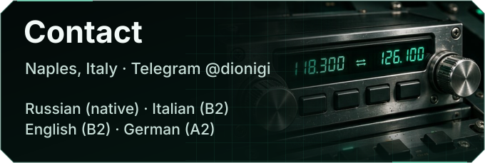

  

  
  
  

<b>🇮🇹 Leggi in italiano</b>

<h2 id="featured-projects"></h2>

<b>VibeShop architecture and source code</b>

| Layer | Where |
|:--|:--|
| Pages | [JSP](https://github.com/Denis7Kom/website-turbo-layout/tree/main/VibeShop/src/main/webapp/jsp) for catalogue, cart, checkout, account and orders |
| Requests | [Servlets](https://github.com/Denis7Kom/website-turbo-layout/tree/main/VibeShop/src/main/java/com/turbolayout): `CartServlet`, `CheckoutServlet`, `LoginServlet`, `SearchServlet` |
| Data access | [DAO classes](https://github.com/Denis7Kom/website-turbo-layout/tree/main/VibeShop/src/main/java/model/dao) for user, artist, concert, product and order |
| Database | [SQL schema](https://github.com/Denis7Kom/website-turbo-layout/blob/main/VibeShop/db/VIBESHOP_FINAL.sql) |
| Access filters | [AuthFilter / AdminFilter](https://github.com/Denis7Kom/website-turbo-layout/tree/main/VibeShop/src/main/java/filter) |

The source includes access filters. Object-level authorisation remains an area for review.

  
  

  
  
  
  

  

