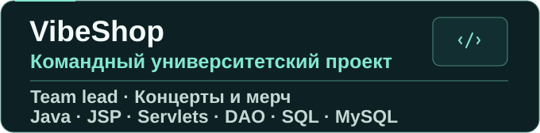
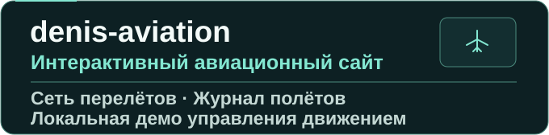
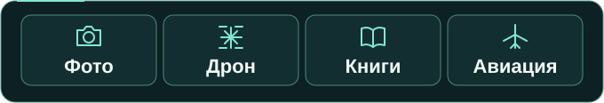

# Denis Komarov
Учусь на Computer Science (L-31) в Университете Салерно. Занимаюсь веб-разработкой на Java.  
Неаполь, Италия · **Открыт к работе**. Ищу стажировки, junior-позиции и фриланс.  
[Telegram @dionigi](https://t.me/dionigi) · [English](./README.md) · [Italiano](./README.it.md)

<picture>
  <source media="(prefers-color-scheme: dark)" srcset="./.github/assets/flight-deck/hero-ru-dark.svg">
  <source media="(prefers-color-scheme: light)" srcset="./.github/assets/flight-deck/hero-ru-light.svg">
  
</picture>

<picture>
  <source media="(prefers-color-scheme: dark)" srcset="./.github/assets/flight-deck/status-ru-dark.svg">
  <source media="(prefers-color-scheme: light)" srcset="./.github/assets/flight-deck/status-ru-light.svg">
  
</picture>

<picture>
  <source media="(prefers-color-scheme: dark)" srcset="./.github/assets/flight-deck/divider-dark.svg">
  <source media="(prefers-color-scheme: light)" srcset="./.github/assets/flight-deck/divider-light.svg">
  
</picture>

## Главные проекты

### VibeShop

**Team lead.** VibeShop — командный университетский проект о живой музыке и мерче.

**Java · JSP · Servlets · DAO · SQL · MySQL**

<picture>
  <source media="(prefers-color-scheme: dark)" srcset="./.github/assets/flight-deck/vibeshop-ru-dark.svg">
  <source media="(prefers-color-scheme: light)" srcset="./.github/assets/flight-deck/vibeshop-ru-light.svg">
  
</picture>

[Репозиторий](https://github.com/Denis7Kom/website-turbo-layout) · [Код на Java](https://github.com/Denis7Kom/website-turbo-layout/tree/main/VibeShop/src/main/java) · [Схема SQL](https://github.com/Denis7Kom/website-turbo-layout/blob/main/VibeShop/db/VIBESHOP_FINAL.sql)

**Каталог VibeShop**  
[ЗАПОЛНИ: скриншот каталога VibeShop]

<picture>
  <source media="(prefers-color-scheme: dark)" srcset="./.github/assets/flight-deck/screenshot-placeholder-dark.svg">
  <source media="(prefers-color-scheme: light)" srcset="./.github/assets/flight-deck/screenshot-placeholder-light.svg">
  
</picture>

**Тестовое оформление заказа VibeShop**  
[ЗАПОЛНИ: скриншот тестового оформления заказа VibeShop]

<picture>
  <source media="(prefers-color-scheme: dark)" srcset="./.github/assets/flight-deck/screenshot-placeholder-dark.svg">
  <source media="(prefers-color-scheme: light)" srcset="./.github/assets/flight-deck/screenshot-placeholder-light.svg">
  
</picture>

Архитектура и оформление заказа

JSP отвечает за страницы, Servlets обрабатывают запросы, а классы DAO работают с MySQL. Каталог, корзина и заказы образуют путь покупки.

### denis-aviation

Интерактивный авиационный сайт с сетью перелётов, журналом полётов и локальной демоверсией управления воздушным движением.

<picture>
  <source media="(prefers-color-scheme: dark)" srcset="./.github/assets/flight-deck/aviation-ru-dark.svg">
  <source media="(prefers-color-scheme: light)" srcset="./.github/assets/flight-deck/aviation-ru-light.svg">
  
</picture>

[Открыть сайт](https://denis7kom.github.io/denis-aviation/) · [Посмотреть код](https://github.com/Denis7Kom/denis-aviation)

**Сеть перелётов denis-aviation**  
[ЗАПОЛНИ: скриншот сети перелётов denis-aviation]

<picture>
  <source media="(prefers-color-scheme: dark)" srcset="./.github/assets/flight-deck/screenshot-placeholder-dark.svg">
  <source media="(prefers-color-scheme: light)" srcset="./.github/assets/flight-deck/screenshot-placeholder-light.svg">
  
</picture>

<picture>
  <source media="(prefers-color-scheme: dark)" srcset="./.github/assets/flight-deck/divider-dark.svg">
  <source media="(prefers-color-scheme: light)" srcset="./.github/assets/flight-deck/divider-light.svg">
  
</picture>

## Безопасность

В командном коде VibeShop есть [параметризованный запрос](https://github.com/Denis7Kom/website-turbo-layout/blob/main/VibeShop/src/main/java/model/dao/UserDAO.java) и [фильтры проверки сессии и роли администратора](https://github.com/Denis7Kom/website-turbo-layout/tree/main/VibeShop/src/main/java/filter). Я изучаю OWASP Top 10, в том числе SQL injection.

<picture>
  <source media="(prefers-color-scheme: dark)" srcset="./.github/assets/flight-deck/security-ru-dark.svg">
  <source media="(prefers-color-scheme: light)" srcset="./.github/assets/flight-deck/security-ru-light.svg">
  
</picture>

## Инструменты

- **Использовал в проектах** · Java, JSP, Servlets, DAO, SQL, MySQL, HTML, CSS, JavaScript, Git и GitHub.
- **Изучаю** · OWASP Top 10, SQL injection и безопасность веб-приложений.

## Проекты на GitHub

Для знакомства с работами начни с VibeShop, если интересует Java, и с denis-aviation, если интересуют интерактивные сайты. [Все репозитории](https://github.com/Denis7Kom?tab=repositories)

## Beyond the Code

Занимаюсь фотографией, снимаю с дрона и пишу книги. Авиация — один из моих главных интересов.

<picture>
  <source media="(prefers-color-scheme: dark)" srcset="./.github/assets/flight-deck/beyond-ru-dark.svg">
  <source media="(prefers-color-scheme: light)" srcset="./.github/assets/flight-deck/beyond-ru-light.svg">
  
</picture>

Фотографии, съёмка с дрона и книги

- [Портфолио фото и съёмки с дрона](https://denis7kom.github.io/Denis-Komarov-PH/)
- [Shutterstock](https://www.shutterstock.com/g/Denis+Komarov%20PH?rid=259170704)
- [Книги](https://www.amazon.it/stores/Denis-Komarov/author/B0CCSK74QC)

## Связаться

Если вы ищете стажёра, junior-разработчика или исполнителя на фриланс, напишите название роли или кратко опишите проект.

  
  

